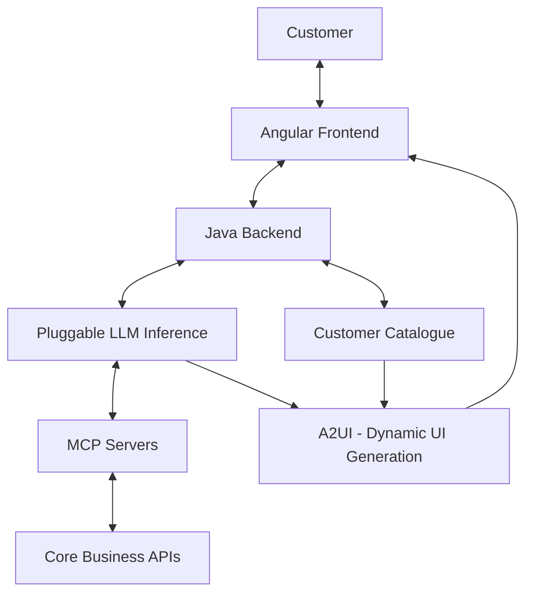

# 🚀 Novaflux
### Intelligent Conversations. Dynamic Experiences. Connected Systems.

Welcome to **Novaflux** – where conversational AI meets dynamic user experiences.

Novaflux is a conversational customer experience platform designed to transform how customers interact with digital services. By combining Large Language Models (LLMs), dynamically generated user interfaces, catalogue-driven interactions, and tool-based API integration, we create experiences that go beyond traditional chatbots.

Our goal is simple: **make customer interactions more natural, contextual, and intelligent.**

---

## 💡 What is Novaflux?

Traditional digital customer portals rely on predefined screens, forms, and navigation flows.

Novaflux takes a different approach.

The user interface is generated dynamically based on the ongoing conversation and the information available in the customer catalogue.

Through conversational AI and MCP-based integration, the platform can access existing business capabilities and data through core APIs exposed as tools.

Instead of forcing customers through predefined workflows, Novaflux enables conversational interactions that generate the appropriate user experience when it is needed.

### Our Core Principles

- 💬 **Conversational First** – Natural language as the primary way to interact with digital services.
- 🧩 **Dynamic UI Generation** – User interfaces generated based on conversational context and customer needs.
- 📚 **Catalogue-Driven Experiences** – Leveraging customer catalogue information to create relevant and contextual interactions.
- 🔌 **MCP-Powered Integration** – Connecting core APIs and business capabilities through MCP servers exposed as tools.
- 🧠 **Pluggable AI Inference** – Flexible LLM integration without tying the platform to a single inference provider.
- ⚡ **Modern Architecture** – A modular, extensible foundation built with modern technologies.

---

## 🏗️ Technology Stack

We leverage a modern technology stack to build a flexible and extensible conversational platform.

| Layer | Technology |
|---|---|
| Frontend | Angular |
| Backend | Java |
| Dynamic UI | A2UI |
| AI / Inference | Pluggable LLM architecture |
| API Integration | Model Context Protocol (MCP) |
| Business Capabilities | Core APIs exposed through MCP tools |
| Interaction Model | Conversational AI |
| UI Generation | Catalogue-driven dynamic interfaces |

### Key Technologies

  
  
  
  
  

---

## 🧠 Architecture at a Glance

Novaflux brings together conversational intelligence, backend services, customer catalogue information, MCP-based API integration, and dynamically generated frontend experiences.

*Conceptual overview of the Novaflux platform. MCP servers expose core API capabilities to the AI layer through tools.*

---

## 🔌 MCP-Powered API Integration

Novaflux uses the **Model Context Protocol (MCP)** to connect conversational intelligence with existing business capabilities.

Core APIs serving business data and functionality are made available through MCP servers and exposed to the LLM as callable tools.

This approach allows the AI layer to interact with existing services without tightly coupling the conversational platform to individual API implementations.

Key benefits include:

- **Standardized Integration** – A consistent protocol for exposing business capabilities to AI.
- **Tool-Based Interaction** – LLMs can discover and invoke available tools to retrieve data and execute supported operations.
- **Separation of Concerns** – Core API implementations remain independent of the conversational and inference layers.
- **Extensibility** – New capabilities can be introduced by adding or extending MCP tools.
- **Reusability** – Business functionality can be made available to different AI models and conversational workflows.

---

## 🧠 Pluggable AI Architecture

AI inference is designed to be independent of a specific LLM provider.

This flexibility allows Novaflux to integrate different inference backends while keeping the conversational experience and application architecture decoupled from the underlying model.

Our approach enables:

- Flexibility in choosing LLM providers.
- Adaptability to evolving AI technologies.
- Separation of inference concerns from application logic.
- Integration with MCP-based tools.
- Freedom to experiment with different models and capabilities.

---

## 🎨 Dynamic User Experiences with A2UI

A key differentiator of Novaflux is its approach to user interface generation.

Rather than relying exclusively on static frontend components and predefined journeys, Novaflux uses **A2UI** to support dynamically generated interfaces.

These interfaces are driven by conversational interactions and information from the customer catalogue.

The result is a more contextual and adaptive customer experience where conversations and user interfaces work together.

---

## 🚀 Our Vision

We believe the next generation of digital customer portals will be more than websites with chat functionality.

They will be intelligent, adaptive experiences that understand customer needs, connect to existing business capabilities, and present the right information and interactions at the right moment.

**Novaflux is our step towards that future.**

---

## 🤝 Explore & Collaborate

This GitHub organization hosts the projects and components that make up the Novaflux ecosystem.

Explore our repositories to discover the technologies, services, and building blocks behind the platform.

---

### Novaflux

**Beyond Chatbots. Beyond Static Interfaces.**

*Building the future of conversational digital experiences.*

